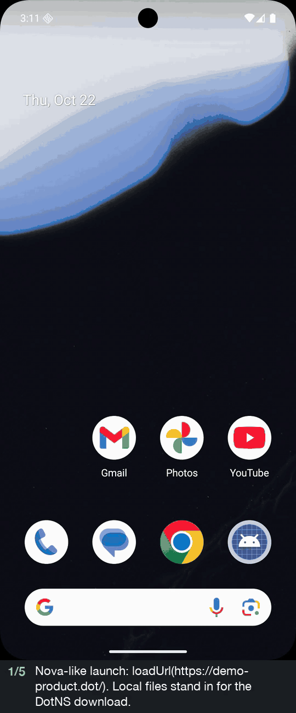
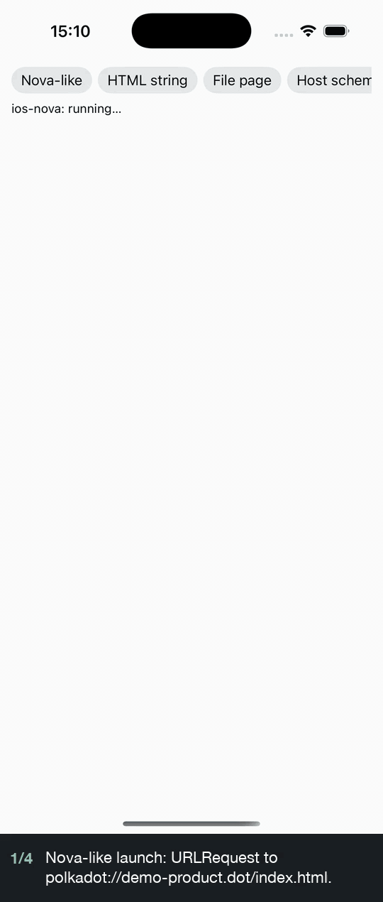

# Host image playground

A native host app shows private contact data in an untrusted product web page.
The page can show the avatar (PNG) and the name (SVG), but its JavaScript cannot read them.
Two small apps test this: Android with `WebView`, and iOS with `WKWebView`. They share Kotlin Multiplatform code.

## Demo

Each demo shows both images. Every read is blocked: 0 leaks.
Recorded on 2026-10-22 on an Android 16 emulator and on an iPhone 17 simulator with iOS 26.4.

| Android | iOS |
|---|---|
|  |  |

The recording of an earlier build is in [docs/details.md](docs/details.md#demo).

## Rules

1. Load the product page from a different origin than the host data.
2. Never send the `Access-Control-Allow-Origin` header on private data.
3. On Android, never turn on `allowUniversalAccessFromFileURLs`.
4. Use the same image size and the same status for every alias.
5. Do not put the name in `alt` text or other DOM text.

[docs/details.md](docs/details.md#rules) gives the reason for each rule.

## Results

A leak is a probe that reads private data. The negative cases must leak. They prove that the probes work.

| Platform | Main scenario | Negative cases | App tests |
|---|---|---|---|
| Android | 0 leaks | 15 and 19 leaks | 5 of 5 pass |
| iOS | 0 leaks | 19 leaks | 5 of 5 pass |

The shared Kotlin tests pass 25 of 25. See the files in [results/android](results/android) and [results/ios](results/ios).
See [docs/details.md](docs/details.md#results-2026-10-22) for every scenario.

## Run

You need:

- JDK 17 or later.
- The Android SDK with platform 36. Set its path in `local.properties`.
- A running Android emulator or device.
- Xcode 26 with an iOS simulator, and `jq`.

The first iOS build downloads Kotlin/Native.

```sh
# Android: shared tests, build, device tests
ANDROID_SERIAL=emulator-5554 ./run-tests.sh

# iOS: shared tests, build, app tests
IOS_SIMULATOR="iPhone 17" ./run-ios-tests.sh
```

Each script exits 0 only if all tests pass. Each script copies the results to `results/`.

To start an app by hand:

- **Android:** install `androidApp/build/outputs/apk/debug/androidApp-debug.apk`. The app opens the `nova` scenario.
- **iOS:** open `iosApp/iosApp.xcodeproj` and run the `iosApp` scheme.
- **Web demo:** run `cd web-demo && bun install && bun run verify`.

## Layout

- `shared/`: shared Kotlin code and unit tests.
- `androidApp/`: the Android app and its device tests.
- `iosApp/`: the iOS app and its XCTest tests.
- `web/`: the product page and probes. Both apps include it.
- `web-demo/`: a separate browser demo on two HTTPS origins.
- `results/` and `docs/`: the last test results, the details, and the demo recordings.

## Not tested

- Other WebView and iOS versions, real iPhones, and physical Android devices.
- The real Nova hosts. The playground copies their loading code but does not run them.
- Timing side channels.
- Alias creation and real contact storage.

These tests check only the listed probes. They do not prove that the data is private in every case.
See [docs/details.md](docs/details.md) for the full text.
