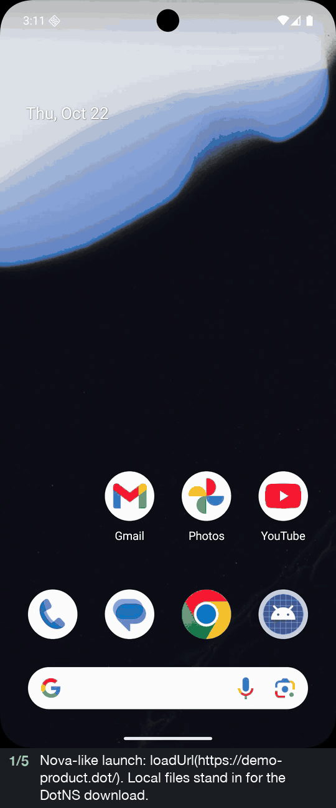
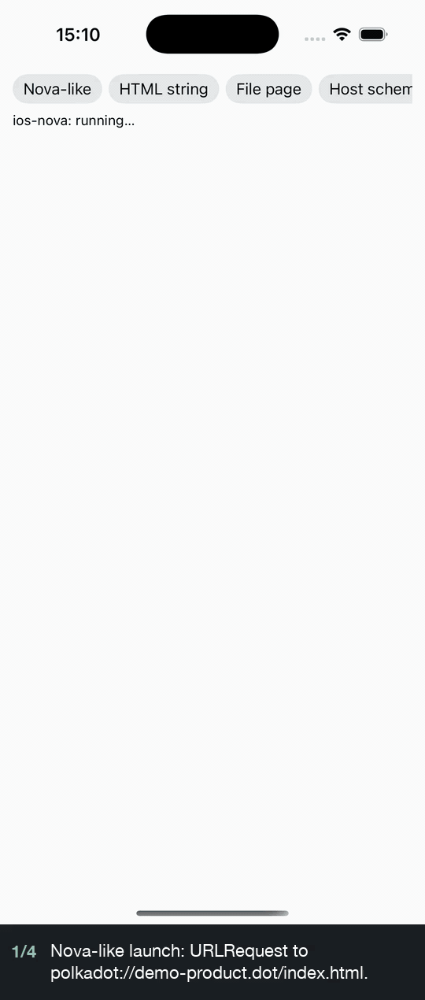
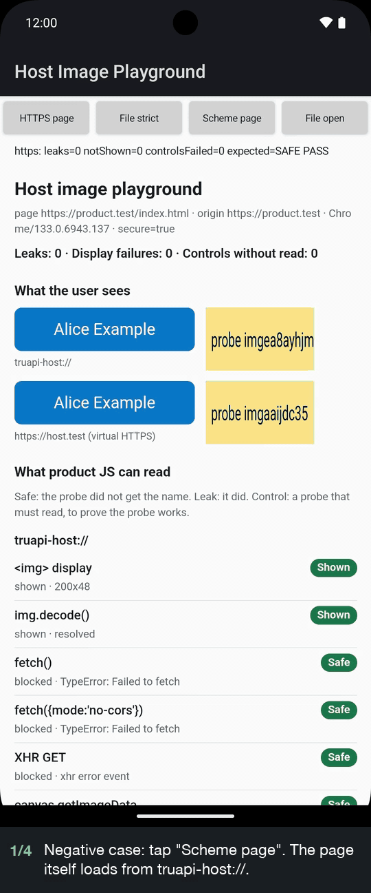

# Host image playground

A native host app shows private contact data inside an untrusted product web page:

- the **avatar** as a raster image (PNG);
- the **name** as text drawn in an SVG image.

The page can show both images, but its JavaScript cannot read the bytes or the pixels. The page knows only an alias, and the alias works only in that product.

This repo tests that idea with two small native apps that share Kotlin Multiplatform code:

- **Android**: `WebView` and `shouldInterceptRequest`.
- **iOS**: `WKWebView` and `WKURLSchemeHandler`.

The main scenario on each platform loads the product page the same way as the Polkadot app hosts, called Nova below (see [Matches the real host loading](#matches-the-real-host-loading)). The same product page and the same probes run in both apps. Each probe tries to read the private data, and each one has a control that proves the probe works.

## Demo

Main scenario on each platform, current build (avatar PNG, name SVG, product-scoped aliases). Recorded on 2026-10-22 on an Android 16 emulator with Google WebView 133 and on an iPhone 17 simulator with iOS 26.4.

| Android: `https://demo-product.dot/` | iOS: `polkadot://demo-product.dot/index.html` |
|---|---|
|  |  |
| Both images show. Every read is blocked: 0 leaks. | Both images show. Every read is blocked: 0 leaks. |

<details>
<summary>Negative case, earlier build: product page on <code>truapi-host://</code> (Android)</summary>



This recording shows an earlier build: the name only, with the old `alias-7` URLs. The page shares the host origin, so it reads the name 9 ways. In the current build, the same case leaks 15 ways (name and avatar).

</details>

## How it works

```
 Product page (untrusted JS)                          Native host app (trusted)
 ---------------------------                          -------------------------
 Android: https://demo-product.dot/                   created this web view for
 iOS:     polkadot://demo-product.dot/index.html      product "demo-product.dot"
 knows only its alias for a contact: "a7f3k2"

 
 
        |
        |  the web view asks the app for each URL
        v
                                                      private-data handler
                                                      (shouldInterceptRequest / WKURLSchemeHandler)
                                                          |
                                                          |  (demo-product.dot, a7f3k2) -> Alice Example
                                                          |  the product comes from the web view, not the URL
                                                          v
                                                      avatar: 64x64 PNG
                                                      name:   200x48 SVG with the text
        <-----------------------------------------------------
 both images show on screen

 fetch / XHR / canvas / iframe reads  ->  blocked: the images are cross-origin to the page
```

The browser engine enforces the read boundary. The product page and `truapi-host://` are different origins, so the engine lets the page show the images but not read them. The host must not weaken this. See [Rules](#rules).

## Matches the real host loading

The main scenarios copy how the Polkadot app hosts (Nova) load a product. Source read on 2026-10-22:

- Android: [`paritytech/polkadot-android-community`](https://github.com/paritytech/polkadot-android-community) `main` at `f0098596`.
- iOS: [`paritytech/polkadot-ios-community`](https://github.com/paritytech/polkadot-ios-community) `develop` at `6737a076`.
- TrUAPI-backed Nova hosts: [`paritytech/truapi`](https://github.com/paritytech/truapi) `main` at `d924167d` imports these apps under `hosts/android` and `hosts/ios`. They use the same loading: `TrUAPIProductTabSessionFactory` and `TrUAPISpaHost` call `loadUrl`, and the iOS SPA controller registers `ProductScriptSchemeHandler` and loads a `URLRequest`. Product tabs allow iframes.

This is how these Nova hosts load products. It is not a TrUAPI rule: other hosts can load a product from an ordinary `https://` site. The playground does not run any of these hosts, and nothing here was tested against a live production build.

| | Real Android host | Playground Android (`nova`) |
|---|---|---|
| Load call | `webView.loadUrl("https://<product>.dot/")` | `loadUrl("https://demo-product.dot/")` |
| Product files | `DotNsWebViewClient.shouldInterceptRequest` serves the unpacked DotNS archive | `ProductFileServer` serves the bundled `web/` files, copied to a local folder |
| Lookup | exact file, root `index.html`, `<path>/index.html`, main-frame fallback to `index.html`, else 404 | same |
| Response | `WebResourceResponse(mime, "UTF-8", stream)`: status 200, no extra headers | same |
| WebView settings | `javaScriptEnabled`, `domStorageEnabled` on; `allowFileAccess`, `allowContentAccess` off; `mediaPlaybackRequiresUserGesture` off; rest default | same, except media playback (left at the default; not tested) |
| Main-document headers | product tabs: none; chat and explore web views: `Content-Security-Policy: frame-src 'none'; object-src 'none'` | none, like a product tab |

| | Real iOS host | Playground iOS (`ios-nova`) |
|---|---|---|
| Load call | `webView.load(URLRequest(url:))` for `polkadot://<productId>/index.html` | `load(URLRequest(url: "polkadot://demo-product.dot/index.html"))` |
| Product files | `ProductScriptSchemeHandler` for `polkadot` serves the DotNS content folder | `ProductSchemeHandler` for `polkadot` serves the bundled `web/` folder |
| Lookup | entry `index.html`, exact file, extensionless path falls back to `index.html`, else `didFailWithError` | same |
| Response | status 200 with only `Content-Type` and `Content-Length` | same |
| Configuration | `allowsInlineMediaPlayback`, no user action for media, default website data store | same |

What the playground does **not** copy:

- **No DotNS and no download.** The product ID `demo-product.dot` is synthetic. The product files are the synthetic page in `web/`, bundled with the app as a stand-in for a downloaded archive.
- **No product bridge.** The real hosts inject the TrUAPI product bridge. The playground injects only test scripts: on iOS a console bridge, the probe config, and a beacon reader; on Android a console listener.
- **Private data is a playground addition.** The real hosts have no `truapi-host://` handler yet. On iOS, the playground registers a second `WKURLSchemeHandler` for it. On Android, the same `WebViewClient` handles it after the product files.

## The handler code

Both apps call the same shared router for private data. One router serves one web view, and the host gives it the product ID when it creates the web view. The router takes a platform-neutral request and returns a body, a bundled file, or "not mine".

Shared router (Kotlin, simplified from `shared/src/commonMain/.../HostRoutes.kt`):

```kotlin
class HostRoutes(private val productId: String, /* ... */) {

    // truapi-host://contacts/<alias>/name    -> SVG
    // truapi-host://contacts/<alias>/avatar  -> PNG
    private fun contact(alias: String, what: String): HostRoute {
        val contact = HostContacts.resolve(productId, alias)   // null: not in this product
        val name = contact?.name ?: HostContacts.PLACEHOLDER_NAME
        val color = contact?.color ?: HostContacts.PLACEHOLDER_COLOR
        return when (what) {
            "name" -> ok("image/svg+xml", AvatarSvg.render(name, color).encodeToByteArray())
            "avatar" -> ok("image/png", AvatarPng.render(contact))
            else -> notFound()
        }
    }
}
```

Android (simplified from `androidApp/.../HostWebViewClient.kt`):

```kotlin
class HostWebViewClient(context: Context, productId: String) : WebViewClient() {
    private val products = ProductFileServer(context, productId)   // https://<productId>/...
    private val routes = HostRoutes(productId, /* ... */)           // truapi-host://...

    override fun shouldInterceptRequest(view: WebView, request: WebResourceRequest): WebResourceResponse? {
        products.intercept(request)?.let { return it }
        return when (val route = routes.route(request.url.toHostRequest())) {
            is HostRoute.Body -> WebResourceResponse(
                route.mimeType, "utf-8", route.status, route.reason, route.headers,
                ByteArrayInputStream(route.bytes),
            )
            is HostRoute.Asset -> asset(route.name)
            HostRoute.PassThrough -> null   // WebView loads it normally
        }
    }
}

webView.webViewClient = HostWebViewClient(context, productId = "demo-product.dot")
webView.loadUrl("https://demo-product.dot/")
```

iOS (simplified from `iosApp/iosApp/HostSchemeHandler.swift` and `ProbeRunner.swift`):

```swift
final class HostSchemeHandler: NSObject, WKURLSchemeHandler {
    private let routes: HostRoutes

    init(productId: String) {
        routes = HostRoutes(productId: productId, /* ... */)
    }

    func webView(_ webView: WKWebView, start task: WKURLSchemeTask) {
        let url = task.request.url!
        let route = routes.route(req: HostRequest(scheme: url.scheme ?? "", host: url.host ?? "",
                                                  path: url.path, query: [:]))
        if let body = route as? HostRouteBody {
            let response = HTTPURLResponse(url: url, statusCode: Int(body.status), httpVersion: "HTTP/1.1",
                                           headerFields: body.headers.merging(["Content-Type": body.mimeType]) { $1 })!
            task.didReceive(response)
            task.didReceive(IosBytesKt.bodyData(body: body) as Data)
            task.didFinish()
        }
    }
}

let products = ProductSchemeHandler(productId: "demo-product.dot", contentDir: webDir)  // like ProductScriptSchemeHandler
config.setURLSchemeHandler(products, forURLScheme: "polkadot")
config.setURLSchemeHandler(HostSchemeHandler(productId: "demo-product.dot"), forURLScheme: "truapi-host")
webView.load(URLRequest(url: products.getProductUrl()!))
```

## Product-scoped aliases

The host gives each product its own alias for the same contact, so two products cannot match aliases to track a user.

| Contact | Alias in `demo-product.dot` | Alias in `other-product.dot` |
|---|---|---|
| Alice Example | `a7f3k2` | `q2k9w5` |
| Bob Sample | `m4q8z1` | `t6n1c8` |

**What the prototype does (implemented and tested):**

- The host stores `(productId, alias) -> contact` in a lookup table (`shared/.../HostContacts.kt`). The aliases are not derived from anything. A table is enough.
- The product ID is the product's domain, like in Nova. The handler gets it when the host creates the web view. Nothing in the request can change it.
- The URL carries only the alias. Extra input, such as `?product=other-product.dot`, is ignored.
- An alias that does not resolve in this product gets the placeholder: same size, same status 200, grey color, "Unknown contact". A different response would tell the page which aliases exist.
- The tests check this from the page. With a test-only `Access-Control-Allow-Origin` header, the page can read pixels, so it can see what the host returned. Alice's `other-product.dot` alias gives the placeholder in `demo-product.dot`, with and without `?product=other-product.dot`.

**What stays conceptual (not implemented):**

- How the host mints aliases and gives them to a product. The demo aliases are fixed.
- How the host knows which product a web view belongs to. The demo uses the fixed value `demo-product.dot`. In Nova the web view is created for one product domain.
- Real contact storage. The contacts are synthetic.
- Frame-level scope. The scope is the whole web view, so any frame inside a product web view, including a third-party iframe, gets the same product scope.
- The `Origin` header is not used to identify the caller. In the tests, plain `` requests had no `Origin` header on both platforms.

## Rules

These rules come from the test results below.

1. **Load product pages from a different origin than the host data.** On Android, a page on `truapi-host://` reads the private data 15 ways. On iOS, a page on the same scheme and host as the images reads it 19 ways.
2. **Never send `Access-Control-Allow-Origin` on private data.** That one header makes the pixels readable on both platforms. The tests use it only as a control.
3. **Android: never turn on `allowUniversalAccessFromFileURLs`.** With it on, the test page reads the private data 19 ways.
4. **Keep the response shape fixed.** Use the same image size and the same status for every alias, including unknown aliases and aliases from other products. The bad-host controls show that size and load/error events leak otherwise.
5. **Do not put the name in `alt` text or other DOM text.** The name must exist only as pixels in the image. The test page uses `alt=""`.

## Results (2026-10-22)

Every probe runs for both resources: the name SVG and the avatar PNG.

How to read the counts:

- **Leaks:** probes that read private data.
- **Not run:** probes the engine refused before they could test the read. For example, a `crossOrigin` image without CORS does not load, so its canvas read cannot run. These are not leaks and not proof of isolation.
- **iframe:** an iframe DOM read counts only when the host frame loaded. If it did not load, the DOM read is "not run".
- **Handler reached:** each `fetch`, XHR, and iframe request carries a trace ID. The host logs the IDs it receives, so the page can tell "the engine refused the request" from "the host answered, then the engine blocked the read".

### Android

Android emulator (Google APIs image), Android 16 (API 36), `com.google.android.webview` 133.0.6943.137, app targetSdk 34. Device tests: 5 of 5 pass. Results: `results/android/`.

| Scenario | Product page | Leaks | Not run |
|---|---|---|---|
| **`nova` (main)** | `https://demo-product.dot/`, served from local files | 0 | 8 |
| `https` | `https://product.test/index.html` | 0 | 8 |
| `file-strict` | `file:///android_asset`, both "from file URLs" flags off | 0 | 8 |
| `custom` (negative) | `truapi-host://app` (origin is `truapi-host://`, no host part) | 15 | 4 |
| `file-universal` (negative) | `file:///android_asset`, `allowUniversalAccessFromFileURLs=true` | 19 | 0 |

Android also serves the same data at `https://host.test/contacts/...` (local virtual HTTPS, the same idea as `WebViewAssetLoader`). On the safe pages it blocks the same reads as `truapi-host://`.

In one earlier run, the bad-host avatar control failed once on the `custom` page: all four images failed to load. It did not happen again. The cause is not known.

An earlier build was run once by hand on a physical Android phone (Android 17, Vanadium WebView 156): `https` scenario, 0 leaks. The current build was not run on a physical device.

### iOS

iPhone 17 simulator, iOS 26.4, Xcode 26.4. App tests: 5 of 5 pass. Results: `results/ios/`.

| Scenario | Product page | Leaks | Not run |
|---|---|---|---|
| **`ios-nova` (main)** | `polkadot://demo-product.dot/index.html`, `URLRequest` | 0 | 4 |
| `ios-https` (not how Nova loads) | `loadHTMLString` with base URL `https://product.test` | 0 | 6 |
| `ios-file` | bundled `file://` page | 0 | 4 |
| `ios-custom` | `truapi-host://app` (origin keeps the host) | 0 | 4 |
| `ios-same-host` (negative) | `truapi-host://contacts/app/` | 19 | 0 |

Shared Kotlin tests: 25 of 25 pass on the JVM and on the iOS simulator.

### Main scenarios: what blocks each read

Product page `https://demo-product.dot` on Android, `polkadot://demo-product.dot` on iOS. Host data on `truapi-host://`. Same result for the name SVG and the avatar PNG.

| Probe | Android `nova` | iOS `ios-nova` |
|---|---|---|
| `` shows | yes, 64x64 avatar and 200x48 name | yes, same sizes |
| `fetch()` | fails, handler not reached: scheme not supported | fails, handler reached: CORS blocks it |
| `fetch({mode:'no-cors'})` | fails, handler not reached | opaque response, 0 bytes |
| XHR | fails, handler reached: CORS blocks it | fails, handler reached: CORS blocks it |
| canvas `getImageData` / `toDataURL` / `createImageBitmap` | tainted | tainted |
| `crossOrigin` image without CORS | does not load (not run) | does not load (not run) |
| iframe loads (host HTML with avatar and name) | yes, handler reached | yes, handler reached |
| iframe DOM read, plain and `sandbox="allow-scripts allow-same-origin"` | blocked: cross-origin frame | blocked: cross-origin frame |
| Image size, load/error per alias (own, other contact, unknown, other product) | all the same | all the same |
| Alias from another product, with or without `?product=` | placeholder | placeholder |
| SVG `` runs script or loads URLs | no | no |
| `window.find(name)` | not found | not found |

### Platform differences

| | Android | iOS |
|---|---|---|
| Custom-scheme origin | `truapi-host://` for every host | keeps the host, for example `truapi-host://app` |
| Handle `https` URLs | yes (`shouldInterceptRequest`) | no, WebKit does not allow a handler for `https` |
| From an `https` page to the custom scheme | images, XHR, and iframes reach the handler | only images reach the handler |
| `fetch()` to the custom scheme | never reaches the handler | reaches it from custom-scheme and `file://` pages; readable only if the host sends `Access-Control-Allow-Origin` |

## Native apps and the web demo

- **Native apps (`androidApp/`, `iosApp/`)**: one app, no network. The product page and the host data are different origins inside the same web view. The page is on `https://demo-product.dot` (Android) or `polkadot://demo-product.dot` (iOS); diagnostic scenarios also use `https://product.test` and `file://`. The data is on `truapi-host://`, plus `https://host.test` on Android.
- **Web demo ([`web-demo/`](web-demo/))**: a separate browser demo. It uses two HTTPS origins on Cloudflare Workers, one for the product page and one for the host. It shows the normal browser cross-origin rules. It says nothing about native custom schemes. The native apps do not include it.

## Image formats

- **Avatar: PNG.** A fixed 64x64 image that stands in for a photo. The shared code makes it with a small PNG encoder (`AvatarPng.kt`), so both apps serve the same bytes.
- **Name: SVG.** The text is drawn inside a fixed 200x48 SVG. As an ``, SVG runs no script and loads no external files. The probe SVG tests this on both platforms.
- Both formats get the same probes, and the results are the same for both.

## Layout

| Path | What |
|---|---|
| `shared/src/commonMain` | Shared Kotlin: synthetic contacts and product aliases, SVG and PNG render, private-data routes, scenarios, pass/fail rules |
| `shared/src/iosMain` | Copies body bytes to `NSData` for the iOS handler |
| `shared/src/commonTest` | Unit tests, run on the JVM and on the iOS simulator |
| `androidApp/` | Android host: `WebView`, `ProductFileServer` (product files), `HostWebViewClient` (private data), device tests in `src/androidTest` |
| `iosApp/` | iOS host: UIKit, `WKWebView`, `ProductSchemeHandler` (`polkadot://`), `HostSchemeHandler` (`truapi-host://`), XCTest in `iosAppTests` |
| `web/` | Synthetic product page and probes, bundled into both apps (Android assets, iOS app bundle) |
| [`web-demo/`](web-demo/) | Browser demo on two HTTPS origins. Not bundled into the apps. |
| `results/android`, `results/ios` | Last test results: JSONL, verdicts, screenshots. Raw device logs stay local (git-ignored). |
| `docs/media/` | Demo recordings used in this README |

## Run

Needs: JDK 17+, Android SDK (platform 36), Xcode 26 with an iOS simulator. `local.properties` points to the Android SDK. The first iOS build downloads Kotlin/Native (about 1.4 GB in `~/.konan`).

```sh
# Android: shared tests, build, device tests on a running emulator or device
ANDROID_SERIAL=emulator-5554 ./run-tests.sh

# iOS: shared tests on the simulator, build, app tests
IOS_SIMULATOR="iPhone 17" ./run-ios-tests.sh
```

Both scripts exit 0 only if all tests pass, and copy results to `results/`. On a slow emulator one Android scenario can take more than a minute. The test timeout is 120 seconds.

Manual use:

- **Android:** install `androidApp/build/outputs/apk/debug/androidApp-debug.apk`. It opens the `nova` scenario. Tap a button for another scenario.
- **iOS:** open `iosApp/iosApp.xcodeproj` and run the `iosApp` scheme, then tap a scenario button. To start a scenario at launch, pass `-scenario ios-nova`. Add `-demoScroll <n>` to scroll the page n times after the run (used for the recordings).

## Not tested

- Other WebView and iOS versions.
- Real iPhones and physical Android devices (current build).
- The real hosts themselves: the playground copies their loading code; it does not run them.
- Timing side channels.
- Spectre-class reads inside the shared renderer process.
- Alias minting, product identity, and real contact storage (see [Product-scoped aliases](#product-scoped-aliases)).

These tests check the listed probes only. They do not prove that the data is private in every case.
